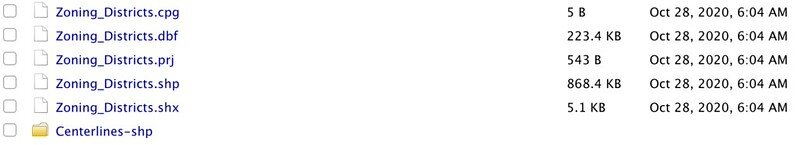
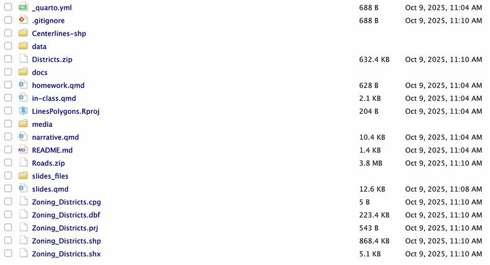
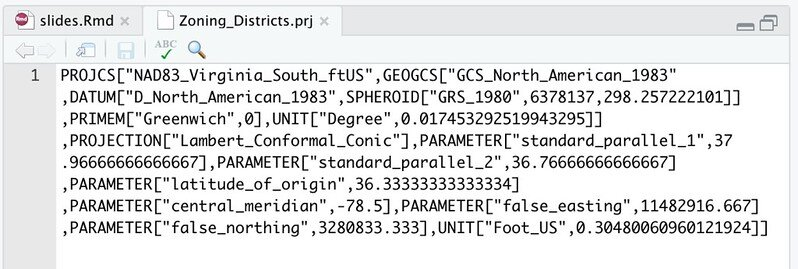

## Learning Objectives 

This section covers the following topics:

- Creation of `sf::LINESTRING` and `sf::MULTIPOLYGON` objects from raw data.  

- Loading map polygons from `map_data()`  

- Importing data from ESRI shapefile.  

- Implementing Spatial Joins.


# Lines {background-color="black" background-image="media/contour.png" background-size="initial" background-position="right"}

```{r startup, include=FALSE}
library( sf )
library( ggplot2 )
library( tidyverse )
library( fontawesome )
knitr::opts_chunk$set( fig.retina = 3, 
                       warning = FALSE, 
                       message = FALSE,
                       fig.align="center")
theme_set( theme_minimal( base_size = 20) )
```


## Data Sources: *De novo* Creation {.scrollable}

It is possible to make data from scratch by entering coordinates directly.


```{r}
set.seed( 543 )
df <- data.frame( id = c(rep("Rodney",5), rep("Sarah",5)),
                  Data = rnorm( 10, 42, 42),
                  Longitude = rnorm(10, -78, 1 ),
                  Latitude = rnorm(10, 37, 1) )
df
                  
```

## Data Sources: *De novo* Creation  {.scrollable}

To make them into `sf` `POINT` objects, use `st_as_sf()` as normal.

```{r}
df %>%
  st_as_sf( coords = c("Longitude", "Latitude"), crs=4326 ) -> pts
pts
```


## Plotting Points {.smaller}


:::: {.columns}

::: {.column width="40%"}

We can easily mix individual aesthetic properties to change the representation of the points provided by using `geom_sf()`.

&nbsp;

```{r eval=FALSE}
ggplot( pts ) + 
  geom_sf( aes(color = id, size=Data)) + 
  coord_sf() + 
  theme(axis.text.x = element_text(angle = 45, 
                                   vjust = 1, 
                                   hjust=1))
```
:::

::: {.column width="60%"}

&nbsp;

&nbsp;

```{r}
#| echo: false
ggplot( pts ) + 
  geom_sf( aes(color = id, size=Data)) + 
  coord_sf()  + 
  theme(axis.text.x = element_text(angle = 45, 
                                   vjust = 1, 
                                   hjust=1) )
        
```
:::

::::


## Data Sources: *De novo* Creation

To make `sf` as `LINESTRING` we can group by the id value and then we need to summarize the `Data` component, then cast it to a Linestring.

```{r}
df %>%
  st_as_sf( coords = c("Longitude", "Latitude"), crs=4326 ) %>%
  group_by( id ) %>%
  summarize( Data = mean( Data ) ) %>%
  st_cast("LINESTRING") -> lines 
```

## &nbsp; {.scrollable}

```{r}
lines
```


## Visualizing Line Objects

:::: {.columns}

::: {.column width="50%"}

Just like when we were working with `POINT` objects, we can use both built-in graphing approaches as well as `ggplot()` for visualizing.  Here I'm going to plot the two line objects using normal graphics. 

```{r eval=FALSE}
plot( lines["Data"], 
      col=c("red","green"),
      lwd = 2)
```
:::

::: {.column width="50%"}

&nbsp;

&nbsp;

```{r echo=FALSE}
plot( lines["Data"], 
      col=c("red","green"),
      lwd = 2)
```
:::

::::


## Operations on `LINESTRING` Objects

Physical length of the `LINESTRING` objects

```{r}
st_length( lines )
```

:::{.fragment}
The bounding box around all the lines.

```{r}
st_bbox( lines )
```

:::{.fragment}

The area of the convex hull encompassing *all* the lines.
```{r}
library( units )
lines %>% 
  st_union() %>% 
  st_convex_hull() %>% 
  st_area() %>%
  set_units( km^2 )
```
:::
:::

## Textual Versions of `geometry`

Any geometry can be written out as *Well Known Text* (WKT), a plain-text description of its shape and coordinates.


```{r}
lines$geometry[1] %>% st_as_text()
```


# Polygons {background-color="black" background-image="media/contour.png" background-size="initial" background-position="right"}

`r fa("circle-notch", fill='limegreen')`


## Polygons

Polygons are simply lines whose first and last coordinate are exactly the same

```{r}
df.p <- df[ c(1:5,1, 6:10,6),]
df.p
```


## Polygon *de novo* Creation

```{r}
df %>%
  st_as_sf( coords = c("Longitude", "Latitude"), crs=4326 ) %>%
  group_by( id ) %>%
  summarize( Data = mean( Data ) ) %>%
  st_cast("POLYGON") -> polygons
```


## &nbsp;

```{r}
polygons
```


## Visualizing Polygon Objects {.smaller}

```{r}
ggplot( polygons ) + 
  geom_sf( aes( fill = Data ), alpha=0.75 ) + coord_sf() + 
  theme(axis.text.x = element_text(angle = 45, vjust = 0.5, hjust=1))
```

## Polygons From Data Frames

```{r}
map_data( "county", "virginia") %>%
  dplyr::select( Longitude = long,
                 Latitude = lat,
                 group,
                 County = subregion) -> va_counties
head( va_counties )
```

## 

```{r fig.width=12}
ggplot( va_counties, aes( Longitude, Latitude) ) + 
  geom_point( size=0.25 ) + 
  coord_quickmap()
```


##

```{r}
va_counties %>%
  filter( County %in%  c("hanover","henrico") ) %>%
  ggplot( aes(Longitude, Latitude) ) + 
  geom_polygon( aes( fill = County), alpha=0.1 ) +
  geom_point( aes( color = County) ) +
  coord_quickmap()
```

##

```{r fig.width=10}
ggplot( va_counties, aes( Longitude, Latitude) ) + 
  geom_polygon( aes( group=group ), fill="grey80",
                color = "black", linewidth = 0.25) + 
  coord_quickmap()
```


## 

```{r}
ggplot() + 
  geom_polygon( aes( Longitude, Latitude, group=group ),
                fill="grey80",color = "black", 
                linewidth = 0.25, data=va_counties) +
  geom_sf( aes( color=Data), 
           lwd=3, data=lines) + 
  coord_sf()
```


# Shapefiles 🤷  {background-color="black" background-image="media/contour.png" background-size="initial" background-position="right"}


## &nbsp; {background-color="white" background-image="https://dyerlabteaching.github.io/Shapefiles/media/shapefile_definition_chatGPT3.png" background-size="contain" background-position="center"}


## Shapefiles

The ESRI *Shapefile* is a non-standardized format for packaging vector based data (`POINT`, `LINESTRING`, `POLYGON`, etc.).  

However, it is not actually a file but it is a collection of files, which may (or may not) expand directly in the folder or within a subfolder.





## Archived ZIP Files.

I've put some shapefiles in the [course data repository](https://dyerlabteaching.github.io/CourseData/).  These are from the Richmond City GIS Department and represent the centerlines of roads in the city as well as the zoning districts.

Here are the URL's for both of these files.

```{r}
roads_url <- "https://dyerlabteaching.github.io/CourseData/Spatial/Richmond_Roads.zip"
district_url <- "https://dyerlabteaching.github.io/CourseData/Spatial/Richmond_ZoningDistricts.zip"
```


## Downloading Files Using R

You can use your browser and copy and paste those addresses in to download the files to your computer.  Then you'll have to move those archives to your PROJECT FOLDER (you are using Projects right?).

:::{.fragment}

`OR`

You can have `R` download the file and save it locally.

```{r}
shp_dir <- tempdir()  # on your computer, use your project's data folder
download.file( district_url, destfile = file.path( shp_dir, "Districts.zip" ) )
download.file( roads_url, destfile = file.path( shp_dir, "Roads.zip" ) )
```

:::

## Unzipping Files

You can open your computer finder and have the OS unzip the archives.

`OR`

You can have `R` do it.

```{r}
unzip( file.path( shp_dir, "Districts.zip" ), exdir = shp_dir )
unzip( file.path( shp_dir, "Roads.zip" ), exdir = shp_dir )
```


## File Components





## The Projection File



## Loading A Shapefile

You can load it in using `sf::st_read()` and passing it the `.shp` file path to it.

```{r}
st_read( file.path( shp_dir, "Zoning_Districts.shp" ) ) -> districts 
```

## Shapefiles Convert to `sf` Objects {.smaller .scrollable}

By default, the data associated with a vector object are put into a `data.frame` and the `geometry` object is properly created.

```{r}
head( districts, n=2 )
```

## Simplifying Data

```{r}
names( districts )
```

## Simplifying Data

```{r}
districts %>% 
  dplyr::select( -Comment, -CreatedBy, -CreatedDat, -EditBy, -EditDate ) %>%
  dplyr::select( -Shape__Are, -Shape__Len) -> districts
head( districts, n=1)
```


## District Codes

```{r}
districts$Name %>% unique() %>% sort()
```


## Visualizing 

```{r}
plot( districts["Name"] )
```


## Visualizing Overlays


```{r}
plot( st_geometry( districts ))
plot( st_geometry( districts[districts$OBJECTID==530,] ), 
      col='red', add=TRUE )
```


# Vector Operations  {background-color="black" background-image="media/contour.png" background-size="initial" background-position="right"}


## Spatial Joins

In the topic covering [Joins](https://dyerlabteaching.github.io/Joins/slides.html), we used *Primary* and *Foreign* Keys to join `data.frame` objects and combine data.  We can do similar operations using geospatial positions to perform `spatial joins`.

There are a wide variety of operations available:

<center><font color="red">Check out the [Cheatsheet](https://github.com/rstudio/cheatsheets/blob/main/sf.pdf)</font></center>


## Secondary Vector Data Set

```{r}
road.shapefile <- st_read( file.path( shp_dir, "Centerlines-shp/tran_Carriageway.shp" ) )
```

:::{.fragment}

```{r}
names( road.shapefile )
```
:::

## Check Projections

<font color="red">Dyer's First Rule: Make Sure Projections Are the Same</font>


```{r}
st_crs( road.shapefile ) == st_crs( districts )
```

:::{.fragment}
If they differed, one could do something like:

```{r eval=FALSE}
road.shapefile %>%
  st_transform( crs = st_crs( districts ) ) -> road.shapefile
```
:::


## Data Cleanup

```{r}
road.shapefile %>%
  dplyr::select( FullName, OneWay, StreetType,
                 SpeedLimit = PostedSpee, Length = SHAPE_Leng,
                 geometry) %>%
  mutate( OneWay = factor( OneWay ),
          StreetType = factor( StreetType) ) -> roads
summary( roads )
```


## Visualizing: Filter Highways & Plot
```{r}
roads %>%
  filter( StreetType %in% c("Highway", 
                            "Highway Interchange",
                            "Ramp")) -> highways
summary( highways )
```


## Plot It 

Let's color this based upon SpeedLimit

```{r echo=FALSE}
plot( highways["SpeedLimit"], lwd=4 )
```


## Visualizing A Single Entity {.smaller}

:::: {.columns}

::: {.column width="50%"}
### Using Normal Filtering
```{r eval=FALSE}
roads %>% 
  filter( FullName == "Three Chopt Road") %>%
  ggplot() + 
  geom_sf( aes(color=SpeedLimit), 
           lwd=2) + 
  coord_sf() + theme(axis.text.x = element_text(angle = 45) )
```
:::

::: {.column width="50%"}
```{r echo=FALSE}
roads %>% 
  filter( FullName == "Three Chopt Road") %>%
  ggplot() + geom_sf(aes(color=SpeedLimit), lwd=2) + coord_sf() + theme(axis.text.x = element_text(angle = 45) )
```

:::

::::


## Intersection Plotting

Let's grab a bit of zoning from *The Fan*

```{r}
districts %>%
  filter( OBJECTID == 368 ) %>%
  st_buffer(dist = 1500) %>%
  st_bbox() -> fan_bbox

districts %>%
  st_crop( fan_bbox ) -> theFan 
```


## 

```{r}
plot( theFan["Name"])
```


## Add Auxiliary Data {.smaller}


```{r}
zone_url <- "https://dyerlabteaching.github.io/CourseData/Spatial/Richmond_ZoningCodes.csv"

theFan %>%
  left_join( read_csv( zone_url ),
             by="Name") %>%
  mutate( Category = factor( Category) ) %>%
  select( OBJECTID, 
          Name, 
          Category, 
          everything() )  -> theFan
```

## &nbsp;

```{r fig.width=12}
ggplot( theFan ) + geom_sf( aes( fill=Category)) + 
  scale_fill_brewer( type="qual", palette = "Set3") + theme_void()
```


## Cropping Roads

```{r}
roads %>% st_crop( st_bbox( theFan )) -> fanRoads
plot( st_geometry( fanRoads ))
```


## Selecting a Single Zone


Add an attribute to the POLYGON's indicating if the district is that big one in the middle of the plot.  Let's plot it to see what the ID is.

```{r}
theFan %>%
  mutate( Target = ifelse( OBJECTID == 368, 
                           TRUE, 
                           FALSE) ) -> theFan
```


## Plot it
```{r}
theFan %>%
  ggplot() + 
  geom_sf( aes(fill=Target) ) + 
  geom_sf_text( aes(label=OBJECTID), size=3 ) +
  coord_sf() + theme_void()
```


## Isolate the District

```{r}
target <- theFan[ theFan$OBJECTID == 368, ]
plot( st_geometry( target ) ) 
```


## &nbsp;

Keep the roads that intersect the target with `st_filter()`.

```{r}
fanRoads %>%
  st_filter( target ) -> targetRoads
targetRoads %>%
  st_drop_geometry() %>% select( `Street Name` = FullName ) %>%
  distinct() %>% arrange( `Street Name` )
```


## &nbsp;

```{r}
targetRoads %>%
  ggplot() +
  geom_sf( data=target  ) +
  geom_sf( color="darkgreen" ) + theme_void()
```


## Questions

::: {layout-ncol="2"}
If you have any questions, please feel free to either post them as an "Issue" on your copy of this GitHub Repository, post to the [Canvas](https://canvas.vcu.edu) discussion board for the class, or drop me an [email](mailto://rjdyer@vcu.edu).

{.middle fig-alt="Peter Sellers looking bored" fig-align="center" width="500"}
:::
